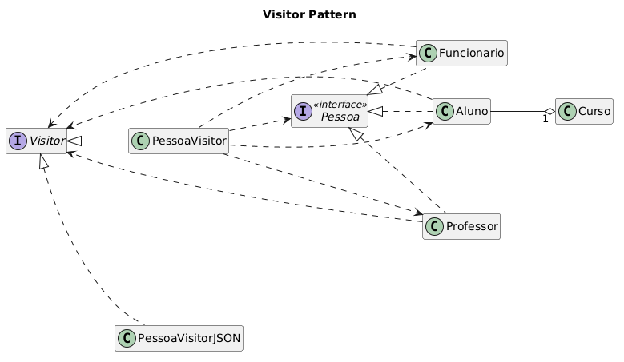

# Visitor-DCC078-2026-3-A
## Content:
Considerando o código do padrão Visitor no repositório da disciplina, foi acrescentado um segundo Visitor para exibir os dados de Alunos, Professores e Funcionários no formato JSON. Incluindo os casos de teste.
## Diagrams:
